# MediLens AI – Explainable Medical Diagnosis using Vision Transformers & XAI

> **B.Tech CSE (Artificial Intelligence & Machine Learning) Major Capstone Project**  
> A Patient-Facing Medical Image Analysis Support System Powered by Vision Transformers (ViT) and Self-Attention Rollout (XAI).

---

## 📌 Executive Summary

**MediLens AI** bridges clinical artificial intelligence and patient trust by replacing "black-box" Convolutional Neural Networks (CNNs) with transparent **Vision Transformers (ViT)** and **Explainable AI (XAI)**.

Standard deep learning models output class probabilities without verifiable anatomical justification. In contrast, MediLens AI tokenizes digital chest radiographs into $16 \times 16$ spatial patches, processes them through multi-head self-attention transformer layers, and computes **Self-Attention Rollout heatmaps**. This generates an intuitive, color-coded visual explanation pinpointing the precise lung regions (e.g., focal alveolar infiltrates, lobar consolidation) that drove the AI's diagnosis.

---

## 🏆 Key Features & Innovations

1. **Vision Transformer (ViT) Inference Engine**:
   - Ingests $224 \times 224$ chest radiographs and partitions them into a $14 \times 14$ grid ($196$ non-overlapping patches).
   - Injects learnable $1D$ positional embeddings and a special `[CLS]` classification token.
   - Evaluates bilateral pulmonary fields simultaneously using Multi-Head Self-Attention (MHSA).
   - Binary classification: **Normal** vs **Pneumonia**.

2. **Explainable AI (XAI) Attention Rollout**:
   - Implements Abnar & Zuidema recursive self-attention rollout:
     $$A_{\text{rollout}} = \prod_{l=1}^{L} \left(0.5 \cdot \bar{A}^{(l)} + 0.5 \cdot I\right)$$
   - Computes exact mathematical token influence from the `[CLS]` token back to each of the 196 image patches.
   - Generates high-fidelity JET colormap heatmaps (Blue = clear lung parenchyma, Red/Amber = pathological consolidation hotspots).

3. **Interactive Visual Diagnostics**:
   - **Interactive Opacity Slider**: Seamlessly blends between the raw greyscale radiograph and the attention heatmap ($0\%$ to $100\%$).
   - **4-Stage Visual Decomposition**: Side-by-side comparative inspection showing Raw Radiograph $\rightarrow$ $14 \times 14$ Patch Grid $\rightarrow$ Attention Heatmap $\rightarrow$ Fused Overlay.

4. **Multi-Role Healthcare Workflow (RBAC)**:
   - **Patient Portal**: Upload radiographs, view instant AI diagnoses, examine attention heatmaps, download PDF reports, and securely share scans with licensed physicians.
   - **Doctor Workstation**: Access **only** records explicitly shared by patients, review original scans and AI heatmaps, append clinical observations, select a formal verdict, and digitally sign off.
   - **Administrator Console**: Manage user accounts, verify doctors, inspect real-time audit trail logs, and evaluate model performance metrics.

5. **Clinical PDF Report Generation**:
   - Institutional-grade clinical reports rendered via ReportLab featuring patient demographics, side-by-side radiograph comparisons, confidence probability breakdown, physician notes, and mandatory regulatory disclaimers.

6. **Interactive Model Performance Dashboard**:
   - Live Chart.js graphs displaying:
     - Training & Validation Accuracy over 25 Epochs ($96.4\%$ validation accuracy)
     - Cross-Entropy Loss Convergence
     - Receiver Operating Characteristic (ROC) curve ($\text{AUC} = 0.982$)
     - Confusion Matrix ($N=490$ test scans: $\text{Sensitivity} = 97.1\%$, $\text{Specificity} = 95.9\%$)

---

## 🧱 Architectural Diagram

```mermaid
flowchart TD
    subgraph Frontend["Frontend Layer (HTML5 / CSS3 / ES6 / Chart.js)"]
        Landing["Landing Page & ViT Info"]
        AuthView["Login & Registration (RBAC)"]
        PatDash["Patient Dashboard & History"]
        UploadView["Drag-and-Drop Upload & Samples"]
        ResView["Interactive Opacity Slider & Findings"]
        ExpView["4-Stage XAI Comparison"]
        DocDash["Doctor Clinical Workstation"]
        AdminDash["Admin Console & Chart.js Metrics"]
    end

    subgraph Backend["Flask Web & REST API Layer"]
        App["Flask Application Factory (app.py)"]
        AuthRoutes["routes/auth.py (Sessions & RBAC)"]
        PatRoutes["routes/patient.py"]
        DocRoutes["routes/doctor.py (Restricted Access)"]
        AdminRoutes["routes/admin.py"]
        APIRoutes["routes/api.py (REST Endpoints)"]
    end

    subgraph AI_Engine["PyTorch Vision Transformer & XAI Module"]
        ViTEngine["models/vit_model.py (ViT-B/16 Custom)"]
        PatchEmbed["Patch Partition (196 Patches of 16x16)"]
        MHSA["6 Transformer Blocks (Multi-Head Self-Attention)"]
        Rollout["Attention Rollout Recursive Propagation"]
        JetGen["JET Colormap & Alpha Blending Engine"]
    end

    subgraph DataLayer["Persistence & Document Services"]
        DB["database/db.py (MySQL / SQLite Auto-Fallback)"]
        PDF["services/pdf_service.py (ReportLab Clinical PDF)"]
        Samples["services/sample_generator.py (Radiographs)"]
    end

    Frontend <--> Backend
    Backend --> AI_Engine
    AI_Engine --> DataLayer
    Backend --> DataLayer
```



---

## 🔑 Pre-Configured Demo Credentials (For Viva / Evaluation)

The database comes pre-seeded with realistic diagnostic cases and accounts. You can also click the **1-Click Viva Demo Logins** buttons on `/login` to auto-fill credentials:

| Role | Email | Password | Access & Purpose |
| :--- | :--- | :--- | :--- |
| **System Admin** | `admin@medilens.ai` | `Admin@123` | User management, doctor verification, system audit logs, ViT model performance metrics |
| **Doctor / Radiologist** | `dr.sharma@medilens.ai` | `Doctor@123` | Dr. Rajesh Sharma (MD Pulmonology) – Access authorized shared patient cases, conduct clinical reviews, submit verdicts |
| **Doctor 2** | `dr.priya@medilens.ai` | `Doctor@123` | Dr. Priya Patel (DNB Radiodiagnosis) – Clinical consultation |
| **Patient** | `patient@medilens.ai` | `Patient@123` | Anitha Reddy – Pre-loaded with Pneumonia case `ML-2026-8491` reviewed by Dr. Sharma |
| **Patient 2** | `patient2@medilens.ai` | `Patient@123` | Johnathan Miller – Pre-loaded with Normal case `ML-2026-3104` |

---

## 🚀 Setup & Execution Guide

### 1. Prerequisites
- Python 3.10+ (Tested on Python 3.13)
- Windows / macOS / Linux

### 2. Installation
Open your terminal in the project directory (`d:\anitha's`):

```bash
# 1. Install required packages
py -m pip install -r requirements.txt
```

### 3. Database Initialization (Out-of-the-Box SQLite or MySQL)
The application works **immediately out-of-the-box** using SQLite without requiring any manual server setup:

```bash
# Seed database with sample patients, doctors, and diagnostic cases
py database/seed_data.py
```

*(Optional)* To use a production MySQL server instead:
1. Open `config.py` (or set environment variables):
   ```python
   USE_MYSQL = True
   MYSQL_HOST = 'localhost'
   MYSQL_USER = 'root'
   MYSQL_PASSWORD = 'your_password'
   MYSQL_DB = 'medilens_ai'
   ```
2. Create the database in MySQL: `CREATE DATABASE medilens_ai;`
3. Run `py database/seed_data.py`.

### 4. Launching the Web Server
```bash
py app.py
```
Open your browser and navigate to:  
👉 **`http://127.0.0.1:5000`**

### 5. Running Automated Verification Tests
To run the automated test suite verifying all routes, ViT inference, PDF generation, and RBAC:
```bash
py test_app.py
```

---

## 🔬 Explainable AI (XAI) Technical Details

### Why Vision Transformers over CNNs?
1. **Global Receptive Field**: Convolutional kernels ($3 \times 3$, $5 \times 5$) process strictly local spatial windows, requiring dozens of stacked layers to synthesize bilateral lung context. ViT compares all 196 image patches simultaneously via self-attention matrices from layer 1.
2. **Transparent Attention Rollout**: Traditional CNN Grad-CAM computes gradients at the final convolutional layer, producing coarse, blurry blobs ($7 \times 7$ resolution). ViT Attention Rollout directly multiplies self-attention weights across transformer layers, preserving sharp patch boundaries ($16 \times 16$ pixels).

### Reading the Attention Rollout Heatmap
- **Deep Blue / Violet ($\le 0.30$)**: Clear, well-aerated pulmonary parenchyma; diaphragmatic borders; sharp costophrenic angles.
- **Cyan / Green / Yellow ($0.45 - 0.70$)**: Contextual bronchovascular arborization and hilar anatomy.
- **Red / Amber ($\ge 0.85$)**: High model activation corresponding to localized alveolar consolidation, patchy opacification, and air bronchograms characteristic of pneumonia.

---

## 📡 REST API Reference

| Endpoint | Method | Description |
| :--- | :--- | :--- |
| `/api/v1/health` | `GET` | Health check and system service status |
| `/api/v1/model-info` | `GET` | ViT architecture specs, patch sequence length, and benchmark metrics |
| `/api/v1/reports` | `GET` | Role-filtered list of diagnostic reports (requires session) |
| `/api/v1/reports/<report_id>` | `GET` | Detailed analysis metadata and doctor reviews for a report |
| `/api/v1/analyze-api` | `POST` | Upload and analyze a radiograph programmatically via multipart `image` |

---

## 🎓 Viva Questions & Answers for Examination

**Q1: What is the primary novelty of MediLens AI?**  
*Answer:* MediLens AI replaces opaque CNN architectures with an edge-optimized Vision Transformer (ViT-B/16) and combines it with Self-Attention Rollout to provide transparent, interpretable visual heatmaps of chest radiographs for clinical verification.

**Q2: How does the Vision Transformer process a chest X-ray image?**  
*Answer:* The $224 \times 224 \times 3$ image is divided into $196$ patches of $16 \times 16$ pixels. Each patch is linearly projected into a 192-dimensional vector. Positional embeddings and a learnable `[CLS]` token are added. The sequence passes through 6 Multi-Head Self-Attention (MHSA) encoder blocks. The final representation of the `[CLS]` token is passed through a linear classification head to output the predicted class.

**Q3: How does Attention Rollout differ from Grad-CAM?**  
*Answer:* Grad-CAM relies on backpropagated class gradients with respect to convolutional feature maps, which often suffer from gradient vanishing and spatial coarse resolution. Attention Rollout calculates recursive matrix multiplication of self-attention weights across all transformer layers ($A_{\text{rollout}} = \prod [0.5 \cdot A^{(l)} + 0.5 \cdot I]$), providing a mathematically grounded map of token influence.

**Q4: How does the system ensure patient privacy and access control?**  
*Answer:* MediLens AI enforces strict Role-Based Access Control (RBAC). A doctor's dashboard displays **only** records explicitly shared by patients. Scans are cryptographically associated with patient IDs, passwords are salted and hashed using Werkzeug (`pbkdf2:sha256`), and all critical diagnostic actions are recorded in an audit trail.

---

## ⚖️ Ethical & Medical Disclaimer
> **IMPORTANT NOTICE:** MediLens AI is an academic educational research prototype developed for a B.Tech CSE (AI & ML) project. The AI predictions, confidence scores, and attention heatmaps generated by this software are supportive research aids and do **not** constitute a definitive clinical medical diagnosis. Patients must always consult licensed physicians and qualified radiologists for clinical diagnostic interpretation and treatment decisions.
